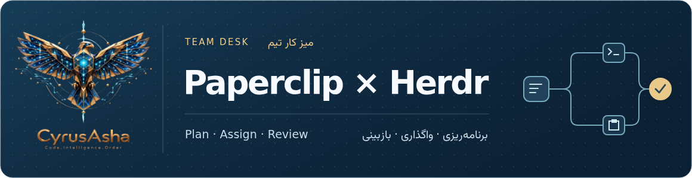
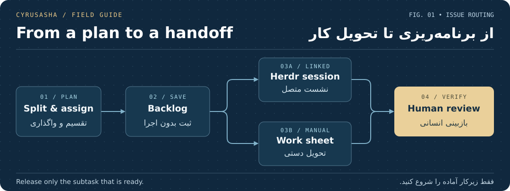
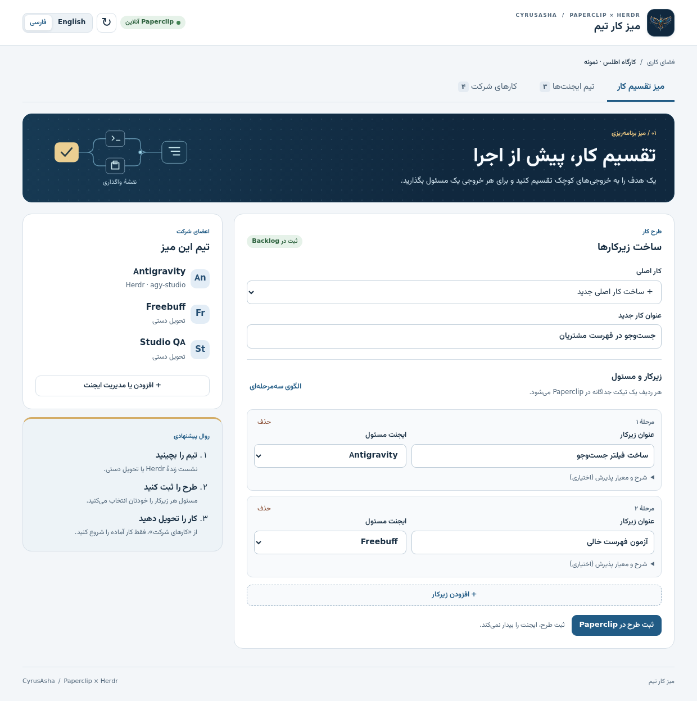
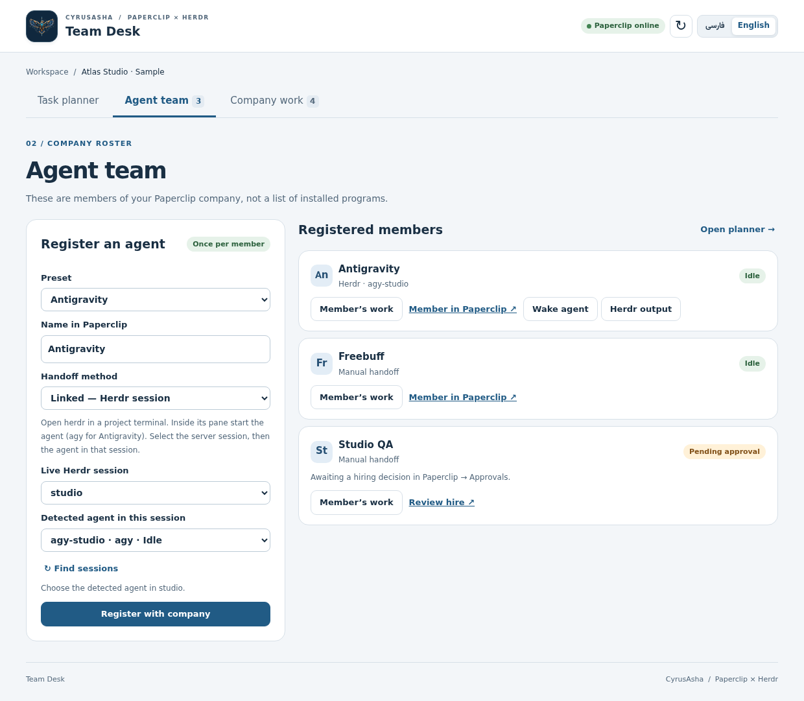
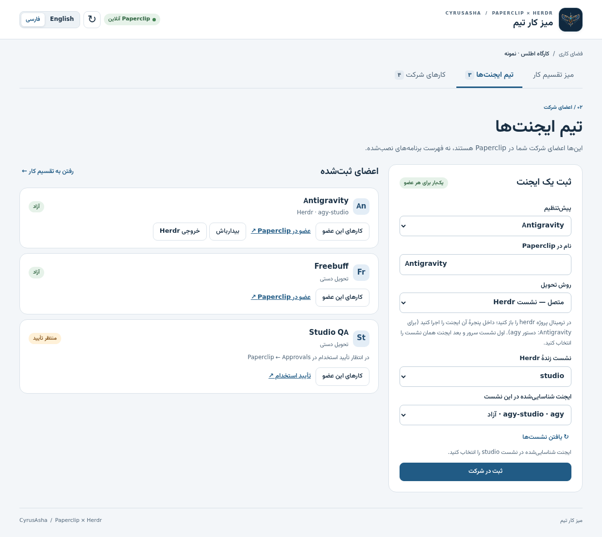

<div align="center">
  
</div>

# 📎 CyrusAsha_PaperclipAndHerdr


**Team Desk / میز کار تیم** · **Version / نسخه: `1.0.0`**

[English](#en) · [فارسی](#persian) · [Screenshots / تصاویر](#screenshots) · [Setup guides / راهنماهای نصب](#guides)

<div dir="rtl" lang="fa">

یک کار را به چند خروجی کوچک بشکنید و هر خروجی را به ایجنت مشخصی بسپارید. **[Paperclip](https://github.com/paperclipai/paperclip)** مسئول هر تیکت و وضعیت بازبینی را نگه می‌دارد. **[Herdr](https://github.com/herdrdev/herdr)** نشست ترمینال ایجنت را فراهم می‌کند. ثبت طرح، هیچ کاری را اجرا نمی‌کند.

</div>

Split a goal into small deliverables and give each one an owner. **[Paperclip](https://github.com/paperclipai/paperclip)** keeps the tickets, assignments and review decisions. **[Herdr](https://github.com/herdrdev/herdr)** provides the running agent session. Saving a plan does not start a run.

---

## 🔀 Handoff map / مسیر واگذاری



<a id="en"></a>

## English

### 🚀 First run

| Requirement | When you need it |
|---|---|
| Node.js **24.15+ on the 24.x line, or 26+**; npm **11.16+** | Installing and starting this repository’s pinned Paperclip server |
| Python **3.10+** | The dashboard and its process worker. Standard library only; no `pip install` or frontend build. |
| Herdr and a signed-in coding agent | Only for linked delivery and terminal output. Planning and manual handoff work without Herdr. |

**Windows:** from the repository root, run `.\setup-dashboard.cmd` in PowerShell. It reuses a ready Paperclip instance or bootstraps the default local one. If an old dashboard is still open, stop **that dashboard** before relaunching; there is no need to stop a healthy Paperclip server.

**Alternatively, use two terminals:**

```sh
npm ci
npm start
```

```sh
python dashboard/app.py --open-browser   # use python3 on macOS/Linux if needed
```

Open **Paperclip** at `http://localhost:3100` (or the URL it prints) and create a company if needed. Open **Team Desk** at `http://localhost:8000`. One company is selected automatically; for multiple companies, set `PAPERCLIP_COMPANY_ID` in `dashboard/.env` and restart the dashboard.

### 🧭 Your first handoff

1. **Agent team:** register Freebuff for **manual** handoff, or start `agy` inside Herdr and link the detected session to Antigravity. Other agents work the same way. Installing a CLI does not create a member in Paperclip. If the company requires approval, review the hire in **Approvals**.
2. **Task planner:** create or select a parent issue, add 1–20 subtasks, and choose an owner on each row. The optional three-step template is editable, not AI-generated. **Save plan to Paperclip** creates assigned issues in `backlog`; it does not send a prompt.
3. **Company work:** release a ready linked task to the queue; Paperclip may wake its owner. For a manual member, choose **Start manually** and paste the **Work sheet** into the agent application, **not a shell**. Review the result in Paperclip. `in_review` is not `done`.

Switch **فارسی / English** in the header at any time. The layout, labels, statuses and desk messages follow the language. Drafts and selections stay in place; company names, issue text and terminal output are not translated. Only the language preference is saved in the browser, not the draft.

<a id="persian"></a>

## فارسی

<div dir="rtl" lang="fa">

### 🚀 اولین اجرا

| پیش‌نیاز | کاربرد |
|---|---|
| **Node.js سری ۲۴ از 24.15 به بعد یا ۲۶ به بالا** و **npm 11.16 یا بالاتر** | نصب و اجرای نسخهٔ قفل‌شدهٔ Paperclip در این مخزن |
| **Python 3.10 یا بالاتر** | داشبورد و worker؛ بدون نیاز به نصب بسته با `pip` یا ساخت جداگانهٔ رابط |
| **Herdr و ایجنتی که ورود به حسابش کامل شده باشد** | فقط برای ارسال متصل و خواندن خروجی ترمینال؛ برای برنامه‌ریزی و تحویل دستی لازم نیست |

**ویندوز:** در PowerShell از ریشهٔ پروژه `.\setup-dashboard.cmd` را اجرا کنید. راه‌انداز از Paperclip آماده استفاده می‌کند یا نمونهٔ محلی پیش‌فرض را بالا می‌آورد. برای دیدن رابط جدید، اگر داشبورد قبلی باز است فقط **داشبورد** را ببندید و دوباره اجرا کنید؛ نیازی به توقف Paperclip آماده نیست.

**روش دو ترمینال:** در اولی `npm ci` و سپس `npm start` را اجرا کنید. در دومی `python dashboard/app.py --open-browser` را بزنید؛ در لینوکس/مک در صورت نیاز از `python3` استفاده کنید.

در **Paperclip** با آدرس `http://localhost:3100` یا آدرسی که سرور چاپ می‌کند، شرکت خود را بسازید. **میز کار تیم** در `http://localhost:8000` باز می‌شود. اگر فقط یک شرکت دارید، خودکار انتخاب می‌شود. برای چند شرکت، `PAPERCLIP_COMPANY_ID` را در `dashboard/.env` مشخص کنید و داشبورد را دوباره اجرا کنید.

### 🧭 اولین واگذاری

1. **تیم ایجنت‌ها:** Freebuff را برای **تحویل دستی** ثبت کنید. برای Antigravity، ابتدا `agy` را داخل Herdr باز کنید و نشست شناسایی‌شده را انتخاب کنید. برای ابزارهای دیگر هم همین دو روش در دسترس‌اند. نصب برنامه به‌تنهایی آن را عضو شرکت نمی‌کند. اگر استخدام منتظر تأیید است، در **Approvals** آن را بررسی کنید.
2. **میز تقسیم کار:** کار اصلی را بسازید یا یک تیکت موجود را انتخاب کنید. برای هر یک از ۱ تا ۲۰ زیرکار، یک مسئول بگذارید. الگوی سه‌مرحله‌ای قابل‌ویرایش است، نه تولیدشده با مدل. **ثبت طرح در Paperclip** تیکت‌ها را در `backlog` می‌سازد؛ پرامپتی نمی‌فرستد.
3. **کارهای شرکت:** فقط زیرکار آماده را به صف اجرا بفرستید؛ Paperclip می‌تواند ایجنت متصل را بیدار کند. برای عضو دستی «شروع دستی» را بزنید و «برگهٔ کار» را در **خودِ برنامهٔ ایجنت، نه شل** بچسبانید. نتیجه را در Paperclip بازبینی کنید؛ `in_review` به معنی `done` نیست.

از بالای صفحه با **فارسی / English** زبان را عوض کنید. جهت صفحه، دکمه‌ها، وضعیت‌ها و پیام‌های میز تغییر می‌کنند، اما متن در حال ویرایش، مسئول انتخاب‌شده، نام شرکت، متن تیکت و خروجی ترمینال دست‌نخورده می‌مانند. مرورگر فقط ترجیح زبان را به خاطر می‌سپارد، نه پیش‌نویس را.

</div>

---

<a id="screenshots"></a>

## 🖼️ Screenshots / تصاویر رابط

Actual dashboard screens with **sample data**, not a live customer board or evidence of agent execution. Click an image for full size. / تصاویر واقعی داشبورد با **دادهٔ نمونه**؛ نه اطلاعات شرکت کاربر یا مدرک اجرای ایجنت. برای اندازهٔ کامل روی تصویر بزنید.

| Page / صفحه | English · LTR | فارسی · RTL |
|---|---|---|
| Task planner / میز تقسیم کار | [](docs/screenshots/planner-en.png) | [](docs/screenshots/planner-fa.png) |
| Agent team / تیم ایجنت‌ها | [](docs/screenshots/team-en.png) | [](docs/screenshots/team-fa.png) |
| Company work / کارهای شرکت | [](docs/screenshots/work-en.png) | [](docs/screenshots/work-fa.png) |

## 🛠️ Troubleshooting / رفع اشکال

| Symptom / نشانه | Next step / اقدام |
|---|---|
| **Refusing to reuse PostgreSQL** / خطای استفادهٔ مجدد از دیتابیس | Do not remove the lock. [Check the existing instance on Windows](docs/SETUP.en.md#postgres-reuse) / [تشخیص فقط‌خواندنی و اتصال به برد قبلی](docs/SETUP.fa.md#postgres-reuse) |
| **Online, no agents** / آنلاین ولی بدون عضو | Check the company shown in the header; register the member and check approvals. / نام شرکت بالای میز را ببینید، عضو را ثبت کنید و تأیید استخدام را بررسی کنید. |
| **No Herdr target** / ایجنت پیدا نمی‌شود | `herdr session list --json` → `herdr --session NAME agent list`. A running server with zero agents is not a missing CLI. [Windows checks](docs/SETUP.en.md#desk-diagnostics) / [فرق نشست، پنجره و ایجنت](docs/SETUP.fa.md#desk-diagnostics) |
| **Agent verification failed** / تأیید Hermes ناموفق است | Open the saved agent's **Harness / Runtime → Run test → Test details**; fix the first error or warning *before* retrying. / [رفع خطای Hermes، مستقل از Herdr](docs/SETUP.fa.md#verification) |
| **`?????` in an issue title** / عنوان ناخوانا | [Choose a readable title on the same issue](docs/SETUP.en.md#issue-title) / [عنوان پیشنهادی برای کار ساخت داشبورد و روش ویرایش `CYR-2`](docs/SETUP.fa.md#issue-title) |
| **Interrupted plan save** / قطع ارتباط وسط ثبت | Retry **the same plan** without reloading. After a reload, check existing issues first. / بدون بستن صفحه «تلاش مجدد همین طرح» را بزنید؛ بعد از بارگذاری مجدد اول تیکت‌ها را ببینید. |
| **Delivery uncertain** / نتیجهٔ ارسال نامشخص | Inspect the issue, run and terminal **before** trying again. / قبل از ارسال دوباره، تیکت، گزارش اجرا و نشست را بررسی کنید. |

## 🔒 Local use / استفادهٔ محلی

The desk has **no login**. Keep the default `127.0.0.1` binding; even a read-only network view can disclose issue text. Keep credentials in `dashboard/.env`, out of screenshots and Git. The UI does not install agents, grant approvals or merge their work.

<div dir="rtl" lang="fa">

داشبورد **ورود کاربر ندارد**؛ آن را روی `127.0.0.1` نگه دارید. حتی نمای فقط‌خواندنی شبکه ممکن است متن تیکت‌ها را نشان دهد. کلیدها را در `dashboard/.env` نگه دارید، نه در تصاویر یا Git. میز کار برنامه‌ای نصب نمی‌کند، استخدام را خودکار تأیید نمی‌کند و شاخه‌ها را ادغام نمی‌کند.

</div>

<a id="guides"></a>

## 📚 Guides & checks / راهنما و آزمون

- [Detailed setup (English)](docs/SETUP.en.md) · [راهنمای کامل نصب، ایجنت‌ها و پل قدیمی (فارسی)](docs/SETUP.fa.md)
- [راهنمای میز و راه‌انداز ویندوز](dashboard/README.md) · [Dashboard architecture / معماری](dashboard/SERVER_ARCHITECTURE.md) · [Tests & screenshot reproduction](dashboard/CONSTRUCTION.md)
- [Verification & limitations / دامنهٔ آزمایش](PROJECT_STATUS.md) · [Security / امنیت](SECURITY.md) · [Contributing / مشارکت](CONTRIBUTING.md) · [Artwork credits / منبع نشان](assets/README.md)

```sh
python -m unittest discover -s dashboard -v   # offline / آفلاین
python dashboard/test_connectivity.py        # read-only check of your Paperclip / بررسی اتصال
```

**CyrusAsha family / پروژه‌های مرتبط:** [GUI for OpenDataLoader PDF](https://github.com/hamzeh-asadi/CyrusAsha_GuiForOpenDataLoaderPDF) · [Setup Global Agents](https://github.com/hamzeh-asadi/CyrusAsha_SetupGlobalAgents) · [Universal RTL](https://github.com/hamzeh-asadi/CyrusAsha_UniversalRTL)
