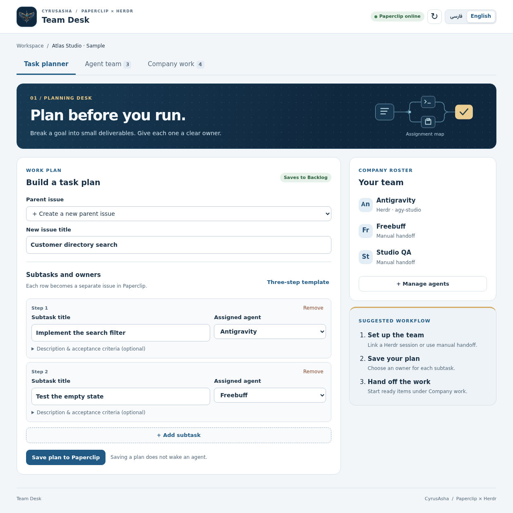
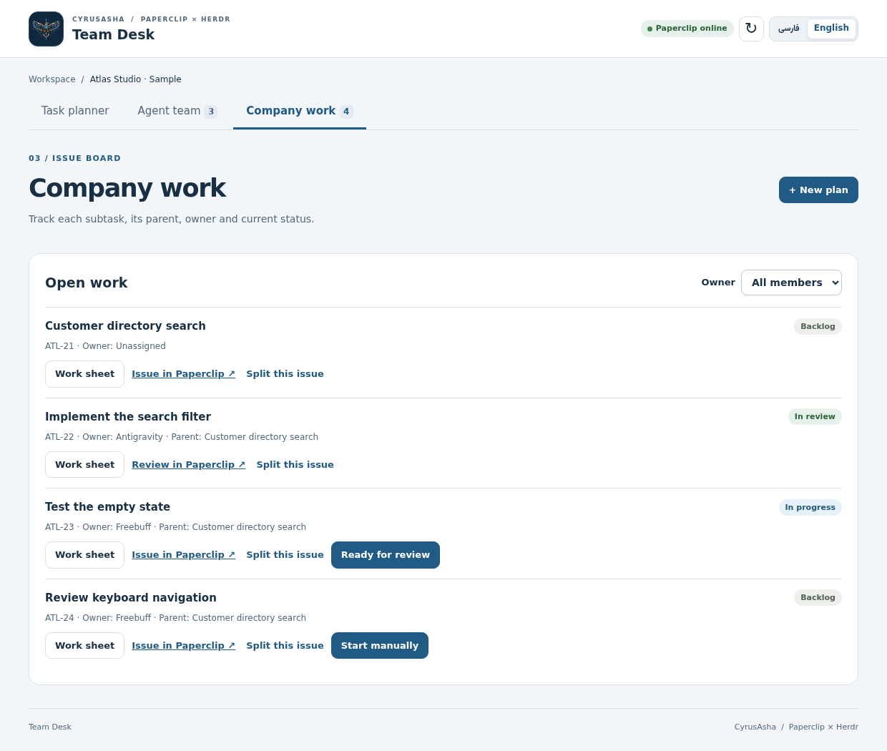
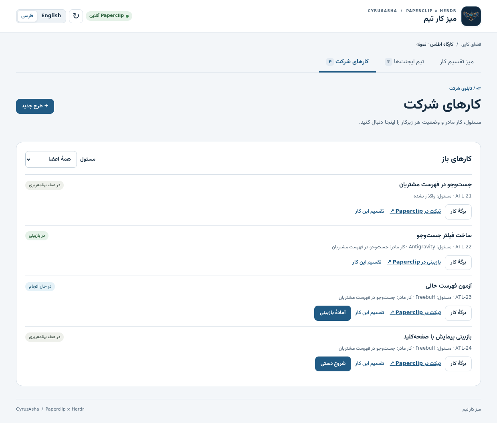

<div align="center">
  
</div>

# 📎 CyrusAsha_PaperclipAndHerdr


**Team Desk / میز کار تیم** · **Version / نسخه: `1.0.0`**

[فارسی](#persian) · [English](#english) · [Configuration](#configuration) · [Project map](#project-map) · [Troubleshooting](#troubleshooting)

---

## این پروژه چیست؟ / What is this?

<div dir="rtl" lang="fa">

یک **میز کار محلی** برای تقسیم یک هدف به چند زیرکار و سپردن هر زیرکار به یک ایجنت مشخص.

- **[Paperclip](https://github.com/paperclipai/paperclip)** شرکت، اعضای تیم، تیکت‌ها، وضعیت‌ها و تصمیم بازبینی را نگه می‌دارد.
- **[Herdr](https://github.com/herdrdev/herdr)** پنجرهٔ ترمینال ایجنت را فراهم می‌کند (نشست، پنجره، ایجنت).
- **میز کار** (این مخزن) فقط واسط و هماهنگ‌کننده است: طرح می‌سازد، عضو ثبت می‌کند، کار آماده را به صف می‌فرستد و خروجی را نشان می‌دهد.

</div>

A **local team desk** that splits one goal into small deliverables and gives each deliverable one owner.
**Paperclip** stores the company, members, issues, statuses and review decisions. **Herdr** provides the running agent terminal. **This desk** is only the coordinator: it creates plans, registers members, releases ready work and shows terminal output.

**What it does / چه کار می‌کند**

| ✅ Does / انجام می‌دهد | ❌ Does not / انجام نمی‌دهد |
|---|---|
| Creates a parent issue plus 1–20 assigned subtasks in `backlog` | Run or install an agent CLI / اجرای ایجنت یا نصب آن |
| Registers a member as **manual** or **linked** to one live Herdr target | Approve a hire or a review for you / تأیید استخدام یا بازبینی |
| Releases a ready issue to Paperclip's run queue | Merge code, push branches or close issues |
| Reads a member's recent terminal output (local only) | Send keystrokes to an arbitrary shell / فرستادن کلید به شل دلخواه |
| Keeps a bilingual UI (فارسی RTL / English LTR) | Translate your issue text or terminal output |

---

<a id="persian"></a>

## 🚀 فارسی — شروع سریع

### ۱) پیش‌نیازها

| نیاز | برای چه کاری | بررسی |
|---|---|---|
| **Node.js سری ۲۴ از 24.15 به بعد یا ۲۶ به بالا** و **npm 11.16+** | اجرای همان نسخهٔ قفل‌شدهٔ Paperclip در این مخزن | `node -v` · `npm -v` |
| **Python 3.10 یا بالاتر** (فقط کتابخانهٔ استاندارد) | میز کار و worker؛ نیازی به `pip install` نیست | `python --version` |
| **Herdr** و یک ایجنت که ورودش کامل شده باشد | فقط برای تحویل متصل و خواندن خروجی؛ برای برنامه‌ریزی و تحویل دستی لازم نیست | `herdr --version` |

### ۲) اجرا

**راه اول (ویندوز، یک دستور):** در PowerShell از ریشهٔ مخزن:

```powershell
.\setup-dashboard.cmd
```

اگر یک Paperclip سالم از قبل در حال اجراست، همان استفاده می‌شود؛ در غیر این صورت نمونهٔ محلی پیش‌فرض بالا می‌آید. برای دیدن رابط جدید، فقط **داشبورد** را ببندید و دوباره اجرا کنید؛ سرور Paperclip را نبندید.

**راه دوم (دو ترمینال):**

```sh
npm ci
npm start                 # Paperclip → http://localhost:3100
```

```sh
python dashboard/app.py --open-browser   # میز کار → http://localhost:8000
```

- در **Paperclip** (`http://localhost:3100`) شرکت را بسازید یا شرکت موجود را باز کنید.
- در **میز کار** (`http://localhost:8000`) یک شرکت خودکار انتخاب می‌شود؛ اگر چند شرکت دارید، `PAPERCLIP_COMPANY_ID` را در `dashboard/.env` بگذارید و میز را دوباره اجرا کنید.

### ۳) مسیر کار (چهار گام)

1. **تیم ایجنت‌ها → ثبت عضو.**
   - **دستی (manual):** فقط نام و نوع. برگهٔ کار را خودتان در برنامهٔ ایجنت می‌چسبانید.
   - **متصل (linked):** ابتدا ایجنت را داخل Herdr باز کنید (مثلاً `agy`)، سپس در میز «یافتن نشست‌ها» را بزنید و **اول نشست سرور، بعد ایجنت همان نشست** را انتخاب کنید.
   - نصب یک برنامه، عضو شرکت نمی‌سازد. اگر شرکت تأیید استخدام می‌خواهد، در **Approvals** بررسی کنید.
2. **میز تقسیم کار → ثبت طرح.** یک کار اصلی بسازید یا انتخاب کنید، ۱ تا ۲۰ زیرکار با مسئول مشخص اضافه کنید. **ثبت طرح در Paperclip** تیکت‌ها را در `backlog` می‌سازد و **هیچ پرامپتی نمی‌فرستد**.
3. **کارهای شرکت → ارسال به صف اجرا.** برای عضو **متصل**، دکمهٔ ارسال وضعیت را به `todo` می‌برد و Paperclip می‌تواند همان عضو را بیدار کند؛ میز پیش از این کار **آماده‌بودن همان هدف Herdr** را بررسی می‌کند و اگر ایجنت روی صفحهٔ onboarding، ورود یا یک دیالوگ اجازه باشد، با پیام روشن جلوی کار را می‌گیرد و تیکت را تغییر نمی‌دهد.
4. **بازبینی.** worker فقط وقتی موفق است که ایجنت روی همان ترمینال تمام کند؛ بعد تیکت را با یک تصمیم **انسان‌محور** به `in_review` می‌برد. `in_review` یعنی «آمادهٔ بازبینی»، نه `done`. نتیجه را در Paperclip تأیید یا رد کنید.

> **تحویل دستی:** برای عضو manual، «شروع دستی» را بزنید و **برگهٔ کار** را در خودِ برنامهٔ ایجنت (نه در شل) بچسبانید؛ پس از پایان کار «آمادهٔ بازبینی» را بزنید.

### ۴) زبان و دادهٔ محلی

از بالای صفحه **فارسی / English** را عوض کنید. جهت صفحه، برچسب‌ها، وضعیت‌ها و پیام‌های میز ترجمه می‌شوند، اما متن تیکت، نام شرکت، پیش‌نویس شما و خروجی ترمینال دست‌نخورده می‌مانند. مرورگر فقط **ترجیح زبان** را ذخیره می‌کند، نه پیش‌نویس را.

---

<a id="english"></a>

## 🚀 English — quick start

### 1) Requirements

| Requirement | When you need it | Check |
|---|---|---|
| **Node.js 24.15+ on the 24.x line, or 26+** and **npm 11.16+** | Running this repository's pinned Paperclip server | `node -v` · `npm -v` |
| **Python 3.10+** (standard library only) | The desk and its worker; no `pip install`, no build step | `python --version` |
| **Herdr** and a signed-in coding agent | Only for linked delivery and terminal output; planning and manual handoff work without it | `herdr --version` |

### 2) Run it

**Windows, one command** from the repository root:

```powershell
.\setup-dashboard.cmd
```

It reuses a healthy Paperclip instance or bootstraps the default local one. To see the new UI, stop **that dashboard** only and relaunch it; there is no need to stop a healthy Paperclip server.

**Two terminals:**

```sh
npm ci
npm start                                # Paperclip → http://localhost:3100
```

```sh
python dashboard/app.py --open-browser    # Team Desk → http://localhost:8000
```

Create or open your company in **Paperclip** (`http://localhost:3100`). **Team Desk** (`http://localhost:8000`) selects the only company automatically; with several companies set `PAPERCLIP_COMPANY_ID` in `dashboard/.env` and restart the desk.

### 3) The workflow (four steps)

1. **Agent team → register a member.**
   - **Manual:** a name and a kind. You paste the work sheet into the agent application yourself.
   - **Linked:** start the agent inside Herdr first (for example `agy`), then use **Find sessions** and pick **the server session, then the agent inside it**.
   - Installing an application is not a company member. If the company requires approval, review the hire in **Approvals**.
2. **Task planner → save a plan.** Choose or create a parent issue, add 1–20 subtasks with an owner on each row. **Save plan to Paperclip** creates the issues in `backlog` and **sends no prompt**.
3. **Company work → release.** For a **linked** member the desk checks the Herdr target first: an agent that is still onboarding, signing in, or waiting on a permission dialog is reported and the ticket is left unchanged. When the target is ready, the issue moves to `todo` and Paperclip may wake that member.
4. **Review.** The worker succeeds only when the agent finishes on the same terminal; it then parks the issue in `in_review` behind a **human-only** decision. `in_review` is not `done`; accept or reject the result in Paperclip.

> **Manual handoff:** release with **Start manually**, paste the **work sheet** into the agent application (never into a shell), then mark **ready for review** when the work is done.

### 4) Language and local data

Switch **فارسی / English** in the header at any time. Layout, labels, statuses and desk messages follow the language; issue text, company names, your draft and terminal output are never translated. Only the language preference is stored in the browser.

---

## 🖼️ Screenshots / تصاویر

Actual dashboard screens with **sample data** — not a live board and not evidence of agent execution. / تصاویر واقعی داشبورد با **دادهٔ نمونه**؛ نه برد واقعی و نه مدرک اجرای ایجنت.

| Page / صفحه | English · LTR | فارسی · RTL |
|---|---|---|
| Task planner / میز تقسیم کار | [](docs/screenshots/planner-en.png) | [](docs/screenshots/planner-fa.png) |
| Agent team / تیم ایجنت‌ها | [](docs/screenshots/team-en.png) | [](docs/screenshots/team-fa.png) |
| Company work / کارهای شرکت | [](docs/screenshots/work-en.png) | [](docs/screenshots/work-fa.png) |

---

<a id="configuration"></a>

## ⚙️ Configuration / تنظیمات

میز کار `dashboard/.env` را می‌خواند (کلیدهای داخل فایل بر متغیرهای محیطی اولویت دارند). / The desk reads `dashboard/.env`; file values win over shell variables.

| Key | Default | Meaning / معنی |
|---|---|---|
| `PAPERCLIP_API_URL` | `http://localhost:3100` | Paperclip base URL / نشانی پایهٔ Paperclip |
| `PAPERCLIP_COMPANY_ID` | *(auto)* | Company to use when more than one exists / شرکت هدف در حالت چند شرکت |
| `PAPERCLIP_API_KEY` | *(empty)* | Board credential for Paperclip; keep it local / اعتبارنامهٔ برد Paperclip |
| `DASHBOARD_HOST` | `127.0.0.1` | Bind address; keep it loopback / آدرس اتصال، فقط محلی |
| `DASHBOARD_PORT` | `8000` | Desk port / پورت میز کار |
| `HERDR_AGENT_MAP` | *(empty)* | Legacy read-only mapping, e.g. `Antigravity=w2:p1,Freebuff=f1` / نگاشت فقط‌خواندنی قدیمی |
| `HERDR_CACHE_TTL` | `10` | Seconds to cache the Herdr agent list / مدت کش فهرست ایجنت‌ها |
| `HERDR_DESK_EXE` | *(auto)* | Absolute `herdr` executable for the worker (set by the desk) / مسیر فایل اجرایی Herdr برای worker |

Paperclip's own settings (port, database, agent keys) live in its instance directory, not in this repository.

---

<a id="project-map"></a>

## 🗂️ Project map / نقشهٔ پروژه

| Path | Responsibility / مسئولیت |
|---|---|
| `dashboard/app.py` | Local HTTP server, static assets, JSON APIs, Paperclip readiness probe / سرور محلی و APIها |
| `dashboard/team_desk.py` | Company-scoped operations: roster, enrolment, plans, release, review / عملیات شرکت |
| `dashboard/herdr_worker.py` | Paperclip `process` worker: picks one ready issue, delivers it to a bound Herdr agent, requests review / worker تحویل |
| `dashboard/paperclip_client.py` | Small JSON client with loopback protection and no redirects / کلاینت JSON |
| `dashboard/desk_text.py` | Bilingual message catalog and rendering / کاتالوگ پیام دوزبانه |
| `dashboard/desk.js` · `i18n.js` · `desk.css` · `index.html` · `strings.json` | Bilingual browser UI, no framework, no build / رابط دوزبانه بدون build |
| `dashboard/test_*.py` | Offline tests (HTTP, desk logic, worker, locale) / آزمون‌های آفلاین |
| `scripts/`, `setup-dashboard.*` | Windows launchers and preflight checks / راه‌اندازهای ویندوز |
| `bridge.sh` | Legacy Bash bridge for older members (not the enrolled worker) / پل قدیمی |
| `docs/SETUP.fa.md` · `docs/SETUP.en.md` | Full setup and troubleshooting guides / راهنمای کامل |
| `dashboard/SERVER_ARCHITECTURE.md` · `PROJECT_STATUS.md` · `SECURITY.md` | API contract, verification limits, security notes / قرارداد API و محدودیت‌ها |

### HTTP API (loopback only / فقط محلی)

| Method & path | Purpose / کاربرد |
|---|---|
| `GET /api/agents` | Company roster with handoff mode and lifecycle state |
| `GET /api/tickets` | Open issues, optionally filtered by assignee/status |
| `GET /api/herdr/sessions` · `GET /api/herdr/targets?session=NAME` | Live Herdr sessions and detected agents |
| `GET /api/agents/<id>/output?lines=&source=` | Recent terminal output of a linked target |
| `POST /api/team/enroll` | Register or reuse a manual/linked member |
| `POST /api/plans` | Create a parent issue and its assigned subtasks in backlog |
| `POST /api/work/advance` | Release a backlog issue, or park a manual one for review |
| `POST /api/agents/<id>/heartbeat/invoke` | Explicit wake of a ready member |
| `GET /health` | Desk status and Paperclip readiness |

---

## ✅ Tests / آزمون

```sh
python -m unittest discover -s dashboard -v    # offline, no network or agents
python dashboard/test_connectivity.py          # read-only check of your own Paperclip
```

Offline tests cover HTTP boundaries, desk transitions, the worker contract and both languages. They simulate Herdr; they do not prove a real agent session on your machine.

---

<a id="troubleshooting"></a>

## 🛠️ Troubleshooting / رفع اشکال

| Symptom / نشانه | Next step / اقدام |
|---|---|
| **Draft plan / شرکت پیدا نشد** | Paperclip را باز کنید و شرکت بسازید؛ برای چند شرکت `PAPERCLIP_COMPANY_ID` را تنظیم کنید. |
| **No Herdr target / ایجنت پیدا نشد** | `herdr session list --json` سپس `herdr --session NAME agent list`. پنجرهٔ باز و شل خالی، ایجنت نیست. [جزئیات](docs/SETUP.en.md#desk-diagnostics) |
| **Agent verification failed** | در Paperclip مسیر **Harness / Runtime → Run test → Test details**؛ اولین خطا/هشدار را رفع کنید. [راهنما](docs/SETUP.fa.md#verification) |
| **Herdr pane waiting for an approval** | ایجنت روی دیالوگ اجازه ایستاده؛ همان دیالوگ را در Herdr پاسخ دهید و کار را دوباره ارسال کنید. تیکت باز می‌ماند. |
| **`EBUSY … .install.lock` (HTTP 500)** | تست محیطی Hermes؛ یک آزمون در هر لحظه، صبر ۳۰–۶۰ ثانیه و پاک‌کردن `%TEMP%\paperclip-ai-*`. [جزئیات](docs/SETUP.en.md#verification) |
| **Unreadable issue title** | عنوان را روی **همان** تیکت در Paperclip اصلاح کنید. [راهنما](docs/SETUP.en.md#issue-title) |
| **Delivery uncertain** | قبل از ارسال دوباره، تیکت، گزارش اجرا و پنجرهٔ ترمینال را بررسی کنید. |

---

## 🔒 Local use / استفادهٔ محلی

The desk has **no login**. Keep the `127.0.0.1` binding: even a read-only network view can disclose issue text. Credentials belong in `dashboard/.env`, never in screenshots, issues or Git. The desk does not install agents, approve hires, merge work or push branches.

داشبورد **ورود کاربر ندارد**؛ آن را روی `127.0.0.1` نگه دارید. کلیدها فقط در `dashboard/.env` بمانند و در تصویر، تیکت یا Git قرار نگیرند.

---

## 📚 Guides / راهنما

- [Detailed setup (English)](docs/SETUP.en.md) · [راهنمای کامل نصب و عیب‌یابی (فارسی)](docs/SETUP.fa.md)
- [Dashboard guide](dashboard/README.md) · [API architecture](dashboard/SERVER_ARCHITECTURE.md) · [Test & screenshot notes](dashboard/CONSTRUCTION.md)
- [Verification limits](PROJECT_STATUS.md) · [Security](SECURITY.md) · [Contributing](CONTRIBUTING.md) · [Artwork credits](assets/README.md)

**CyrusAsha family:** [GUI for OpenDataLoader PDF](https://github.com/hamzeh-asadi/CyrusAsha_GuiForOpenDataLoaderPDF) · [Setup Global Agents](https://github.com/hamzeh-asadi/CyrusAsha_SetupGlobalAgents) · [Universal RTL](https://github.com/hamzeh-asadi/CyrusAsha_UniversalRTL)
